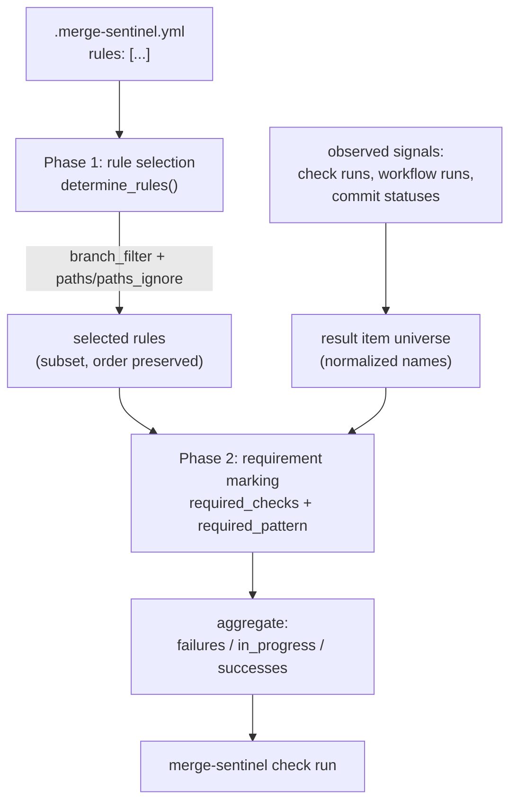

# Job matching: `.merge-sentinel.yml` rules

This document describes exactly how Sentinel turns a repository's `.merge-sentinel.yml`
into a decision about which CI jobs are *required* for a pull request, and how those
required jobs are aggregated into the `merge-sentinel` check run.

Everything here is derived from the code; the authoritative implementations are:

| Concern | Location |
| --- | --- |
| Config/rule schema | `src/sentinel/model.py:11` (`Rule`), `src/sentinel/model.py:20` (`Config`) |
| Config fetch (projection path) | `src/sentinel/projection/evaluator.py:1012` (`_get_repo_config`) |
| Config fetch (legacy path) | `src/sentinel/github/__init__.py:158` (`get_config_from_repo`) |
| Rule *selection* (shared) | `src/sentinel/github/__init__.py:495` (`determine_rules`) |
| Path filter predicate (shared) | `src/sentinel/github/__init__.py:541` (`rule_apply_changed_files`) |
| Requirement marking + aggregation (projection path) | `src/sentinel/projection/evaluator.py:1206` (`_evaluate_rows`) |
| Requirement marking + aggregation (legacy path) | `src/sentinel/github/__init__.py:186` (`populate_check_run`) |
| Changed-files fallback read | `src/sentinel/projection/evaluator.py:1094` (`_get_pr_files`) |

Rule *selection* is shared between the projection and legacy evaluators — both call
`determine_rules`. Requirement marking and aggregation are implemented twice, with
small but real behavioural differences (see [Legacy vs projection](#legacy-vs-projection)).

## 1. The config file

### Schema

```yaml
# .merge-sentinel.yml
allow_extra_failures: false      # parsed, but currently unused (see note below)
rules:
  - branch_filter: []            # list[str], fnmatch patterns against the PR base branch
    paths: null                  # list[str] | null, fnmatch patterns against changed files
    paths_ignore: null           # list[str] | null, fnmatch patterns against changed files
    required_checks: []          # set[str], exact check names that must succeed
    required_pattern: []         # list[str], fnmatch patterns; matched checks become required
```

Validation is strict: both models set `extra="forbid"` (`src/sentinel/model.py:7`), so an
unknown or misspelled key anywhere in the file is a hard validation error, not a warning.

Defaults, when omitted:

- `rules` defaults to `[Rule()]` — a single rule with no filters and no requirements.
  That rule always matches, but marks nothing as required.
- An empty file (YAML parses to `None`) is treated as the default `Config()`.
- `rules: []` yields *no* rules at all — also nothing required.

In all three "nothing required" cases the gate still fails if **any** observed check
fails, because failure aggregation is not restricted to required items
(see [§4](#4-aggregation)).

> **`allow_extra_failures` is dead config.** It is declared on `Config`
> (`src/sentinel/model.py:22`) and therefore accepted in YAML, but it is never read
> anywhere in `src/`. Setting it has no effect; extra (non-required) failures always
> fail the gate.

### Where the file is read from

`api.get_content()` (`src/sentinel/github/api.py:162`) requests
`/repos/{owner}/{repo}/contents/.merge-sentinel.yml` **without a `ref`**, so the config is
always read from the repository's **default branch**, never from the PR head or the PR
base branch. A PR that modifies `.merge-sentinel.yml` is therefore evaluated against the
default branch's version of the rules; the change only takes effect after it merges.

Fetch outcomes in the projection path (`_get_repo_config`):

| Outcome | Behaviour |
| --- | --- |
| 200 | Parsed with `yaml.safe_load` + `Config.model_validate`; activity `config_fetch/loaded` |
| 404 | Config treated as `None` → evaluation returns `no_config` and nothing is published |
| other error | Re-raised → evaluation result `error` |
| validation error | Pydantic `ValidationError` propagates → evaluation result `error` |

Results (including the `None` for 404) are cached **per repository** for
`PROJECTION_CONFIG_CACHE_SECONDS` (default 300) in an in-process dict, keyed by
`repo_id`. Consequences worth knowing:

- A config fix can take up to 5 minutes to be picked up, and the cache is per-process.
- The cache is not keyed by branch or SHA, so all PRs in a repo share one config.
- `OVERRIDE_CONFIG` (`src/sentinel/config.py:37`), the local-file development override, is
  only honoured by the **legacy** loader (`src/sentinel/github/__init__.py:167`). The
  projection evaluator ignores it.
- The legacy loader wraps validation errors in `InvalidConfig` and publishes a check run
  containing the parse error and the raw file (`src/sentinel/github/__init__.py:636`).
  The projection evaluator has no such reporting — a broken config surfaces only as an
  `error` evaluation and log line.

## 2. Two-phase matching model

Matching is two distinct phases, and conflating them is the most common source of
confusion:



- **Phase 1** decides *whether a rule applies at all*, using PR-level facts (base branch,
  changed files). A rule that is not selected contributes nothing.
- **Phase 2** takes the union of the selected rules' `required_checks` and
  `required_pattern` entries and marks observed jobs as required, inventing placeholder
  items for requirements that were never observed.

Selected rules are **additive** — there is no first-match-wins and no precedence. If two
selected rules mark overlapping checks, the check is simply required. There is no way for
a rule to *un*-require something another rule required.

### Glob semantics (applies to every pattern field)

All four pattern fields (`branch_filter`, `paths`, `paths_ignore`, `required_pattern`) use
Python's `fnmatch.fnmatch`. This is **not** the same as GitHub Actions' path filters:

- `*` matches any characters **including `/`**. `paths: ["src/*"]` matches
  `src/a/b/c.py`, and `paths: ["*.md"]` matches `docs/guide.md`, not just top-level
  `*.md` files.
- `**` is not a distinct operator; it behaves like `*`. `docs/**` matches `docs/a/b.md`
  but does **not** match the bare path `docs`. `**/*.py` does **not** match a top-level
  `top.py`.
- `?` (single char), `[seq]`, and `[!seq]` character classes are supported.
- Matching is case-sensitive on Linux and macOS (`fnmatch` case-folds via
  `os.path.normcase`, which is identity on POSIX).
- Patterns are matched against the whole string, unanchored-prefix behaviour does not
  apply — `src` will not match `src/a.py`, you need `src/*`.

## 3. Phase 1 — rule selection (`determine_rules`)

For each rule, in config order:

### `branch_filter`

```python
if len(rule.branch_filter) > 0:
    if not any(fnmatch(pr.base.ref, f) for f in rule.branch_filter):
        continue  # rule rejected
```

- Empty/omitted list → **no branch constraint**, rule stays eligible.
- Non-empty → OR semantics; at least one pattern must match.
- Matched against the PR's **base** branch (the merge target), not the head branch.
- The ref is the short name (`main`, `release/v1`), not `refs/heads/main`. In the
  projection path it comes from `pr_heads_current.base_ref`, populated from
  `pull_request.base.ref` (`src/sentinel/storage/webhook_store.py:1800`), and is passed
  in as `_RulePullRequestLike(base=_RuleBaseRef(ref=pr_row.base_ref or ""))`
  (`src/sentinel/projection/evaluator.py:238`). A missing `base_ref` degrades to `""`,
  which matches no non-trivial pattern, so the rule would be dropped.

### `paths` / `paths_ignore`

The path block is evaluated **only if at least one of the two keys is present** (`None`
means absent; `[]` means present-and-empty, which is not the same thing). It delegates to
`rule_apply_changed_files`:

```python
accepted = True
if paths is not None:
    accepted = accepted and len(paths) > 0 and any(
        fnmatch(f, p) for f in changed_files for p in paths
    )
if paths_ignore is not None:
    matches = [any(fnmatch(f, p) for p in paths_ignore) for f in changed_files]
    accepted = accepted and (len(paths_ignore) == 0 or not all(matches))
```

Semantics:

- `paths`: rule applies if **any** changed file matches **any** pattern.
- `paths_ignore`: rule is rejected only if **every** changed file matches some ignore
  pattern. A single non-ignored file keeps the rule alive.
- Both keys present: `paths` must accept **and** `paths_ignore` must not reject.
- Calling `rule_apply_changed_files` with neither argument raises `ValueError`; the caller
  guards against this.

Edge cases, all load-bearing:

| Input | Result | Why |
| --- | --- | --- |
| `paths: []` | rule always **rejected** | explicit `len(paths) > 0` guard |
| `paths_ignore: []` | no effect (rule kept) | short-circuited by `len(paths_ignore) == 0` |
| `paths: [...]`, empty `changed_files` | rejected | `any(...)` over nothing is `False` |
| `paths_ignore: [...]`, empty `changed_files` | **rejected** | `all([])` is `True`, so `not all(matches)` is `False` |

The last row is the surprising one: with an empty changed-file list, *every* path-filtered
rule drops out — including `paths_ignore`-only rules, which intuitively read as
"apply unless everything is ignored".

### When `changed_files` is empty

The projection evaluator only pays for the PR-files API read when it has to
(`src/sentinel/projection/evaluator.py:211`):

```python
has_path_rules = any(
    rule.paths is not None or rule.paths_ignore is not None for rule in config.rules
)
if has_path_rules and self.config.PROJECTION_PATH_RULE_FALLBACK_ENABLED:
    changed_files = await self._get_pr_files(...)
```

So `changed_files` stays `[]` when:

- no rule uses `paths`/`paths_ignore` (harmless — nothing consumes it), **or**
- `PROJECTION_PATH_RULE_FALLBACK_ENABLED=false` while path rules *do* exist.

In the second case, combined with the table above, **every path-based rule is silently
dropped**, so their `required_checks`/`required_pattern` stop being enforced and the gate
can go green on a PR that should have been held. Treat
`PROJECTION_PATH_RULE_FALLBACK_ENABLED=false` as incompatible with path-filtered rules.

Changed files are fetched via `GET /repos/{repo}/pulls/{n}/files` and cached under
`(repo_id, pr_number, head_sha)` for `PROJECTION_PR_FILES_CACHE_SECONDS` (default 86400).
Because the head SHA is part of the key, a new push re-reads the file list; the long TTL
is safe for a fixed SHA.

## 4. Phase 2 — requirement marking and aggregation (`_evaluate_rows`)

### 4.1 Building the result-item universe

Before any rule is applied, the evaluator builds a `name -> _ResultItem` map from the
projection rows (or from a fresh API snapshot, see [§5](#5-api-refresh-paths)).

**Check runs.**

1. Drop Sentinel's own check run: rows where `app_id == GITHUB_APP_ID` **and**
   `name == PROJECTION_CHECK_RUN_NAME` (default `merge-sentinel`).
2. **Name normalization** — if the row's `check_suite_id` maps to a `workflow_runs_current`
   row with a name, the item name becomes `"{workflow name} / {job name}"`; otherwise the
   raw check-run name is used. This mirrors what GitHub displays in the PR checks list, and
   it is the name your `required_checks`/`required_pattern` entries must target.
3. **Deduplication by normalized name** — for collisions the winner is the max of
   `_check_row_recency_key` (`src/sentinel/projection/evaluator.py:1326`):
   `(last_seen_at, 1 if status in (queued, in_progress, pending) else 0, completed_at,
   started_at, check_run_id)`. Same `last_seen_at` prefers an *active* run over a
   completed one — a re-run in flight beats the stale finished attempt. Note that check
   runs from different check suites that normalize to the same name collapse into one item.

**Commit statuses.** For each `commit_status_current` row with a non-null context and
state, skipping context `== PROJECTION_CHECK_RUN_NAME`:
`failure`/`error` → `failure`; `success` and `pending` pass through; anything else is
dropped. Statuses are written into the map **after** check runs, so on a name collision
the commit status **overwrites** the check run.

`observed_names` is snapshotted at this point — it is the set of names that actually came
from GitHub signals, and is later used to distinguish real failures from synthesized ones.

### 4.2 Status derivation

Check run → item status (`_status_from_check_run`, `src/sentinel/projection/evaluator.py:1666`):

| `status` | `conclusion` | item status |
| --- | --- | --- |
| `completed` | `failure`, `cancelled` | `failure` |
| `completed` | `success` | `success` |
| `completed` | `neutral`, `skipped` | `neutral` |
| `queued`, `in_progress`, `pending` | any | `pending` |
| anything else (incl. `completed` with `timed_out`, `action_required`, `stale`, or null) | | `pending` |

Two things follow. `neutral`/`skipped` jobs are neither failing nor blocking — a required
skipped job lets the gate go green. And unmapped conclusions such as `timed_out` and
`action_required` fall through to `pending`, so a required job that times out **blocks**
the gate as pending forever rather than failing it.

Commit status state → item status: `failure`/`error` → `failure`, `success` → `success`,
`pending` → `pending`, everything else dropped.

### 4.3 Applying the selected rules

For each selected rule (union across rules):

**`required_checks`** — a set, matched by **exact string equality** against normalized
item names:

- every observed item whose name is in the set is flipped to `required=True`;
- every entry in the set with no matching item is inserted as a synthetic item with
  status `missing` and `required=True`.

Because names are normalized to `"{workflow} / {job}"`, `required_checks` entries must
include the workflow prefix for GitHub Actions jobs. Bare job names silently become
permanent `missing` items — the gate stays pending indefinitely, which is the usual
symptom of a mis-specified `required_checks`.

**`required_pattern`** — each pattern is `fnmatch`ed against every current item name:

- all matching items are flipped to `required=True`;
- if a pattern matches **nothing**, a synthetic item named after the pattern itself is
  inserted with status **`failure`** (not `missing`), and the pattern is recorded in
  `missing_pattern_failures`.

That asymmetry is deliberate: an unmatched `required_checks` name is "not here yet"
(pending), while an unmatched `required_pattern` is "this class of job should exist"
(failure) — and it is what arms the auto-refresh in [§5](#5-api-refresh-paths).

### 4.4 Aggregation

```python
failures           = [i for i in items if i.status == "failure"]
explicit_failures  = [i for i in failures if i.name in observed_names]
in_progress        = [i for i in items if i.required and i.status in ("pending", "missing")]
required_successes = [i for i in items if i.required and i.status == "success"]
```

Note the asymmetry in what `required` gates:

- **Failures ignore `required` entirely.** Any failing check on the head SHA — required or
  not — fails `merge-sentinel`. This is what makes `allow_extra_failures` a no-op.
- **Pending only blocks when required.** A non-required job still running does not hold
  the gate.

Conclusion, in precedence order (`src/sentinel/projection/evaluator.py:346`):

| Condition | check run status | conclusion | title |
| --- | --- | --- | --- |
| any `failures` | `completed` | `failure` | `Failed: N \| Pending: N \| Successful: N` |
| else any `in_progress` | `in_progress` | — | `Pending: N \| Successful: N` |
| else | `completed` | `success` | `Pending: N \| Successful: N` |

The `Pending:` and `Successful:` counters in the title/summary count **all** items, not
just required ones, while `in_progress` (what actually blocks) counts only required ones —
so a title can read `Pending: 3` while the gate is green.

The rendered check-run body is a table of every result item with a `Required?` column, so
the published output is the fastest way to debug a rule: it shows the exact normalized
names Sentinel saw and which of them your rules marked as required.

## 5. API refresh paths

Evaluation normally reads only projection tables. There are three ways it reads GitHub
instead, all of which write the snapshot back through to the projection tables
(`_load_head_rows_from_api`, `src/sentinel/projection/evaluator.py:1565`):

1. **Manual refresh** — `trigger.force_api_refresh`, set when a user clicks the
   `refresh_from_api` requested action on the published check run.
2. **`missing_refresh`** (`_should_auto_refresh_on_missing`, `:1365`) — fires only when
   *all* of: auto-refresh enabled; `missing_pattern_failures` is non-empty; there are **no**
   `explicit_failures` (i.e. no real observed failure); PR `updated_at` is older than
   `PROJECTION_AUTO_REFRESH_ON_MISSING_STALE_SECONDS`; and the per-trigger cooldown
   (`PROJECTION_AUTO_REFRESH_ON_MISSING_COOLDOWN_SECONDS`) has expired.
3. **`stale_running_refresh`** (`_should_auto_refresh_on_stale_running`, `:1476`) — a
   required pending item whose check row is still `queued`/`in_progress`/`pending` and whose
   `last_seen_at` is older than the same stale threshold. Shares the same cooldown map.

After a refresh, `_evaluate_rows` is re-run against the fresh rows with the **same selected
rules** — Phase 1 is not redone, so a refresh never changes which rules apply, only what
was observed.

The API snapshot applies the same app-id exclusions as webhook ingress
(`WEBHOOK_FILTER_APP_IDS` plus `GITHUB_APP_ID` when `WEBHOOK_FILTER_SELF_APP_ID`), so
excluded apps' check runs cannot reappear through the fallback.

## 6. Ingress filters interact with matching

Two settings drop signals *before* they ever reach a projection table, which means rules
can never see them:

- `CHECK_RUN_NAME_FILTER` (`src/sentinel/web.py:77`) — a regex applied with `re.match`
  (prefix-anchored) to `check_run.name` and to `status.context`. Matching events are
  skipped entirely. Note it is applied to the **raw** check-run name, before workflow-name
  normalization.
- `WEBHOOK_FILTER_APP_IDS` / `WEBHOOK_FILTER_SELF_APP_ID` (`src/sentinel/web.py:197`) —
  skip events by source app id.

A required check that is filtered at ingress behaves exactly like a check that never ran:
`required_checks` → permanent `missing` (gate pending), `required_pattern` → synthetic
`failure` (gate red).

## 7. Worked examples

Assume the PR targets `main`, changed files are `src/core.cpp` and `docs/intro.md`, and
the observed signals normalize to `CI / build`, `CI / test`, `Docs / html`, and a commit
status `codecov/patch`.

```yaml
rules:
  # (a) always applies: base branch main or any release/*
  - branch_filter: ["main", "release/*"]
    required_checks:
      - "CI / build"
      - "CI / test"

  # (b) only when non-docs files changed
  - paths_ignore: ["docs/*"]
    required_pattern: ["CI / *"]

  # (c) only when docs changed
  - paths: ["docs/*"]
    required_checks: ["Docs / html"]

  # (d) never applies here: no matching branch
  - branch_filter: ["gh-readonly-queue/*"]
    required_checks: ["Merge queue / gate"]
```

Phase 1:

- (a) selected — `main` matches `main`.
- (b) selected — not every changed file matches `docs/*` (`src/core.cpp` does not), so
  `paths_ignore` does not reject.
- (c) selected — `docs/intro.md` matches `docs/*`.
- (d) rejected — no branch pattern matches `main`.

Phase 2: `CI / build`, `CI / test` (from (a), reinforced by (b)'s pattern) and
`Docs / html` (from (c)) are required. `codecov/patch` stays non-required — but if it
fails, the gate still fails.

Now change the PR to touch only `docs/intro.md`: (b) drops out (every changed file matches
`docs/*`), but (a) still requires the `CI /` checks by name — path filters only gate the
rules that carry them. To make CI genuinely optional for docs-only PRs, the
`required_checks` in (a) would need to move into a `paths_ignore`-filtered rule.

## 8. Legacy vs projection

The legacy evaluator (`populate_check_run`, `src/sentinel/github/__init__.py:186`) shares
Phase 1 but differs in Phase 2:

| Aspect | Projection (`_evaluate_rows`) | Legacy (`populate_check_run`) |
| --- | --- | --- |
| Workflow-name prefix source | `workflow_runs_current` joined on `check_suite_id` | per-job `GET /actions/jobs/{id}` + run lookup |
| Non-PR-event workflow runs | kept | removed unless run `event` is `pull_request`/`pull_request_target` (`:251`) |
| GHA identification | any check run with a mapped workflow name | hardcoded `app.id == 15368` / slug `github-actions` (`:198`) |
| Dedup tiebreak | `_check_row_recency_key` (last-seen, active-preferred, …) | latest `completed_at`, nulls win |
| Unmatched `required_pattern` | synthetic `failure` + auto-refresh trigger | synthetic `failure`, no refresh machinery |
| Config override file | ignored | `OVERRIDE_CONFIG` honoured |
| Invalid config reporting | error result only | dedicated check run with parse error + raw file |
| Failure aggregation | all failures, required or not | same |

Anything you rely on for the live gate should be reasoned about with the projection path;
legacy only runs when `WEBHOOK_DISPATCH_ENABLED` is set.

## 9. Practical gotchas

1. Config is read from the **default branch** — rule changes in a PR do not apply to that
   PR, and take up to `PROJECTION_CONFIG_CACHE_SECONDS` to be picked up after merge.
2. `required_checks` needs the **normalized** `"{workflow} / {job}"` name; a bare job name
   parks the gate on `missing` forever.
3. `*` crosses `/` and `**` is not special — `fnmatch`, not GitHub Actions globs.
4. `paths: []` rejects the rule; `paths_ignore: []` is a no-op; an empty changed-file list
   rejects **any** path-filtered rule.
5. Non-required failures fail the gate; `allow_extra_failures` does not change that (it is
   never read).
6. `neutral`/`skipped` satisfies a requirement; `timed_out`/`action_required` map to
   `pending` and block indefinitely.
7. A commit status and a check run sharing a name collapse to one item, with the status
   winning.
8. Unknown keys and typos in `.merge-sentinel.yml` are fatal (`extra="forbid"`), and in the
   projection path they surface only as an `error` in logs/metrics — not on the PR.
9. `CHECK_RUN_NAME_FILTER` and app-id filters can make a required check invisible, which
   looks identical to the job never having run.
